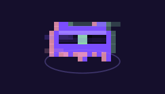
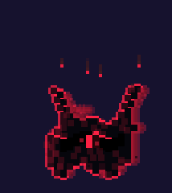
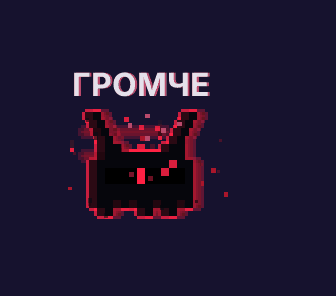
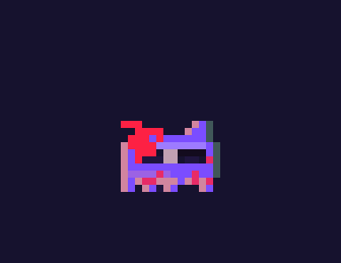
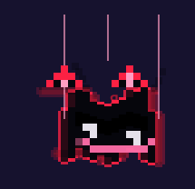
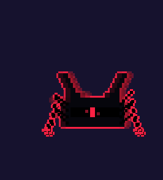
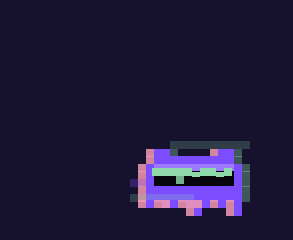
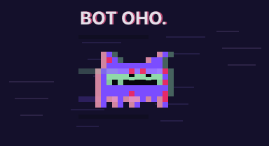

# ДЕМОН · ПОДМЕНЫШ

Two pixel creatures that live on a Linux desktop and **listen to your music**.

- **ДЕМОН** (*demon*) studies every song and dances to it. A witness: the song is the main character, he is the one who feels it.
- **ПОДМЕНЫШ** (*changeling*) is the thing that takes his place: a dark red copy that moves like Death Grips sounds. No smooth motion, only snaps, holds and cuts. It wears his shape, fakes his dances, and sometimes eats the fake.

They hear songs live (`cava` on PipeWire), map them after one play (sections, drops, mood), and react: hype arcs that detonate on the drop, a cute mask on cute-but-dark songs, a forgery mode for nightcore edits, hunts, rituals, and a terminal dock that watches your prompt.

**▶ [Watch the film and play with the genres](https://zumdudd.github.io/demon/)** · 92 s, one song, eight genres, every frame from the real code.

  
  &nbsp;&nbsp;
  

| | | |
|:-:|:-:|:-:|
|  **ДЕТОНАЦИЯ** · blows up on the drop |  **ЗАРАЖЕНИЕ** · takes his place |  **ПРИМАНКА** · a cute mask on a dark song |
|  **ПОДДЕЛКА** · a sped-up forgery |  **ПАСТЬ** · eats the copy of him |  **КАДР** · «ВОТ ОНО.» this is it |

All 20 scenes are in `media/gifs/`. They are rendered by `tools/showcase-render-v2.py`, which runs the pet's own drawing code on a fake clock with a scripted song, so what you see is what it does on the desktop.

## Credits
- **Concept, art direction, every yay / nay:** ШУМ (shum) · [github.com/zumdudd](https://github.com/zumdudd)
- **Code:** written by Claude (Anthropic) from ШУМ's direction, session by session. See `CREDITS.md`.
- **Music** (`media/track/`): ШУМ × Claude, synthesized from scratch in Python (`tools/showcase-track-v3.py`), no samples.

## Runs on
Linux Mint (Cinnamon, X11), Python 3 + GTK3 + cairo, PipeWire + `cava`. Built for one PC; expect to adapt paths.
Map of the code: `lib/zarya/INDEX.md` · history: `CHANGELOG.md` · structure: `MODULES.md`.

## License
Code: MIT (`LICENSE`). Characters, art and music: CC BY 4.0 (`LICENSE-ART.md`).
